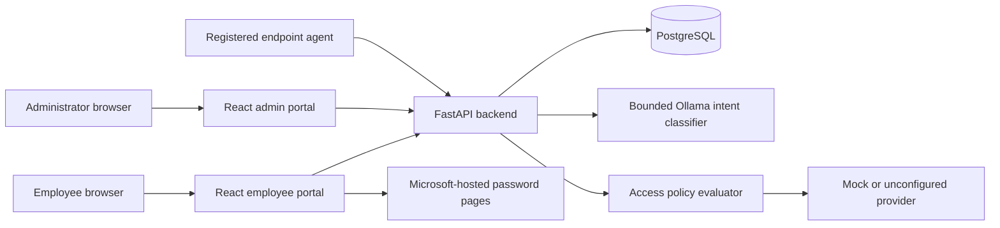
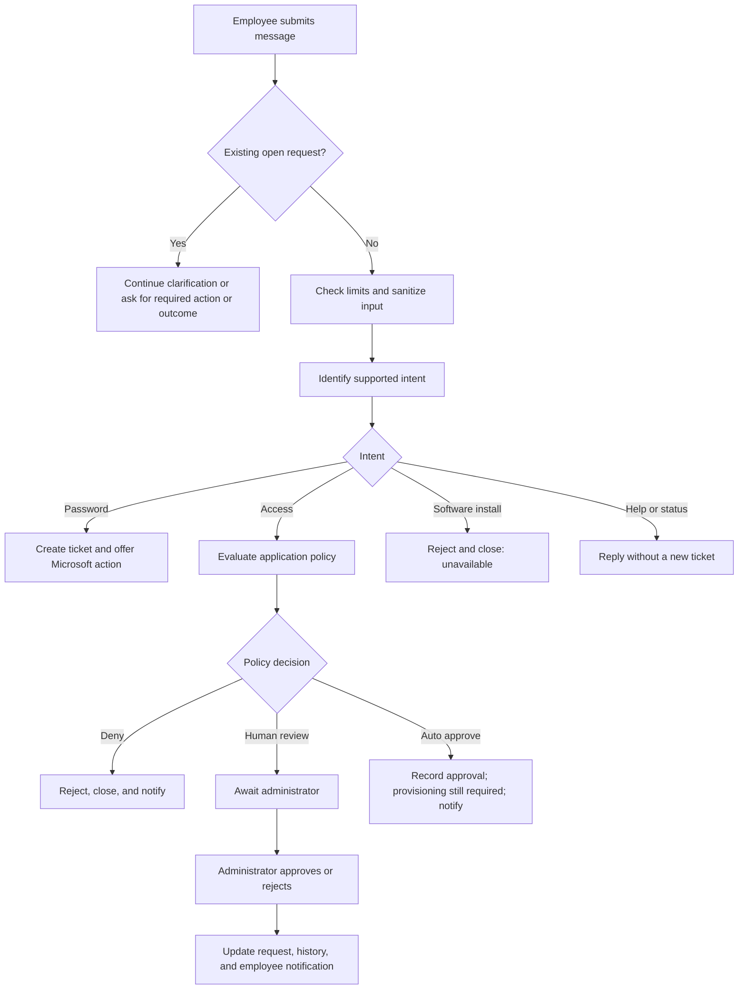

# AutoDeskAI: Project Documentation

**Project type:** AI-assisted IT helpdesk prototype

**Audience:** Employees, IT administrators, project reviewers, and developers

**Implementation covered:** The current repository, as of October 2026

## Contents

1. [Project overview](#1-project-overview)
2. [Purpose and problem addressed](#2-purpose-and-problem-addressed)
3. [Who uses it](#3-who-uses-it)
4. [What the current product does](#4-what-the-current-product-does)
5. [How an employee uses it](#5-how-an-employee-uses-it)
6. [How an administrator uses it](#6-how-an-administrator-uses-it)
7. [How the system works](#7-how-the-system-works)
8. [Data and privacy model](#8-data-and-privacy-model)
9. [Security measures](#9-security-measures)
10. [Impact and value](#10-impact-and-value)
11. [Technology and deployment](#11-technology-and-deployment)
12. [Current limitations and next steps](#12-current-limitations-and-next-steps)

## 1. Project overview

AutoDeskAI is a web-based service desk for a small, defined set of workplace IT requests. Employees can ask for help in a chat interface, request access to catalogued applications, follow links to Microsoft's password tools, and track their requests. Administrators can review employee requests, configure application access rules, make approval decisions, and inspect request history.

The assistant helps identify what the employee needs. The backend, rather than the language model, owns request creation, policy checks, status changes, access decisions, and audit records. This separation is central to the project: a conversational interface makes the service easier to use, while explicit rules control what the system can actually do.

AutoDeskAI is a **prototype**, not a system that grants production application access or installs software. Application provisioning is simulated. Password changes and resets take place on Microsoft-hosted pages, and AutoDeskAI cannot independently verify whether they succeeded. New software installation requests are rejected because that workflow is not implemented.

## 2. Purpose and problem addressed

An employee may not know which IT process applies to a problem, where to submit it, or whether a previous request is still waiting for action. Administrators need a consistent way to review requests and understand why an access decision was made. AutoDeskAI brings those steps into one portal.

The project is intended to:

1. Give employees one place to describe supported IT issues and see their progress.
2. Guide password requests to Microsoft's appropriate hosted experience without handling the employee's organization password.
3. Apply configured rules to application access requests and route cases needing human judgment to an administrator.
4. Keep a traceable record of requests, decisions, and employee-reported outcomes.
5. Be honest about incomplete or unverified work instead of presenting a simulation as a real installation or access grant.

## 3. Who uses it

| User | What they use AutoDeskAI for |
| --- | --- |
| Employee | Chat with the IT assistant, submit and track requests, use Microsoft password links, request application access, report whether an issue was resolved, and read access-decision notifications. |
| Administrator | Review employee requests and escalations, manage the application catalog and its approval policies, approve or reject access requests, inspect request history, and manage registered devices. |
| Endpoint agent | A separate simulation component that authenticates as a registered device and can report results for historical or test tasks. It receives no new installation tasks from the current employee software flow. |

Employees and administrators have separate portal views. An account must sign in through the appropriate role. Administrator registration requires a private backend invite code.

## 4. What the current product does

| Capability | Current behavior | Boundary |
| --- | --- | --- |
| Conversational support | Classifies supported requests, asks for clarification when needed, gives fixed help and status replies, and creates tracked tickets for supported workflows. | General-purpose questions are outside the assistant's scope. |
| Password reset and change | Opens a request and offers the correct Microsoft-hosted action. The backend records when the employee chooses **Continue at Microsoft**. | AutoDeskAI does not receive the organization password or verify Microsoft's outcome. |
| Application access | Evaluates a catalog policy; automatically approves, rejects, or sends a request for administrator review. | Approval means provisioning is required. Built-in provisioning never grants real access. |
| Software installation | Explains that installation is unavailable, rejects the request, and closes it automatically. | No new endpoint installation task is created. |
| Resolution and escalation | Employees report **Resolved** or **Not resolved** for requests that need their outcome. Unresolved requests may allow a password retry or go to an administrator. | Resolution is a person's report, not independent proof of a provider result. |
| Notifications | Stores approval and rejection notices for access requests, including direct chat denials, and shows unread decisions as a visible notice and in the employee portal bell. | Notices are in the portal; the project does not send email or SMS. |
| Audit and history | Shows administrators employee-created request records and lets them open the associated event history. | Internal login and policy events remain in the database but are not rows in the admin request list. |

## 5. How an employee uses it

1. **Sign in.** The employee signs in with a username or email and the AutoDeskAI account password. The browser restores the session after a reload within the same tab session.
2. **Start a request.** The employee types in chat, uses a dashboard quick action, or opens the Application Access page. Every submitted chat message appears in the conversation before the assistant responds.
3. **Clarify if necessary.** If the application or action is unclear, AutoDeskAI asks a targeted question. The employee's answer is checked against the pending request rather than silently starting unrelated work.
4. **Follow the relevant action.** For a password request, the employee chooses **Continue at Microsoft**. For application access, the employee sees the policy outcome or waits for an administrator. A software installation request receives an immediate explanation and rejection.
5. **Track progress.** My Requests shows request type, status, time, outcome, and details. The request timeline shows recorded events. Access decisions also appear in the notification bell.
6. **Report the outcome when required.** Before starting another request, the employee can be asked whether the current issue was resolved. Rejected tickets are already closed and do not require this confirmation.

The chat accepts an employee's message even while another request is open. It displays that message, then responds according to the open request. A new request cannot bypass a pending clarification, action, or resolution step through either chat or quick actions. Chat history is retained in the browser tab session and cleared on sign-out; tracked backend tickets retain a sanitized request description rather than the raw conversation.

### Example: password reset

An employee says, “I forgot my password.” AutoDeskAI creates a password-reset request and offers Microsoft Self-Service Password Reset. When the employee chooses **Continue at Microsoft**, the backend records that the link was issued. The employee completes any identity checks on Microsoft's site. On returning, they can report whether the issue was resolved. AutoDeskAI does not infer success merely because the link was opened.

### Example: application access

An employee requests Tableau access. The backend checks the Tableau catalog entry, requested role, duration, and configured conditions. The policy may approve the request automatically, deny it, or require an administrator. If an administrator later approves or rejects it, the employee sees the updated request and a persistent portal notification. An approved result means **access still needs to be provisioned**; it is not a claim that Tableau permissions already exist.

### Example: unavailable installation

An employee asks to install Visual Studio Code. AutoDeskAI explains that software installation is not implemented, records a rejection, and closes the ticket. It does not ask the employee to confirm a result and does not send an installation task to the endpoint agent.

## 6. How an administrator uses it

Administrators have a workspace for employee requests, access approvals, application policies, registered devices, and audit review.

- **Request review:** See employee tickets and their current state. An unresolved issue escalated by an employee can be marked resolved or rejected with a reason.
- **Access decisions:** See requests awaiting review and approve or reject them. Rejection requires a reason; administrators cannot decide their own access requests. A decision is recorded on the access request and in its event history, and the requester gets a notification.
- **Policy configuration:** Add or edit catalog entries, allowed roles, durations, risk, approval mode, conditions, and fallback behavior. Each edit increments a policy version and stores a revision snapshot. Existing requests retain the version used when they were evaluated.
- **Audit review:** The admin Audit Logs page presents employee-created requests with the employee's username and a link to request details and history. It is a request-centered view, not a list of every internal system event.
- **Device administration:** Enroll and disable registered devices for the retained endpoint simulation. Enrollment returns an agent token once; the backend stores its digest.

## 7. How the system works

The frontend is a React/Vite application. It sends authenticated requests to FastAPI, displays ticket and policy state, and periodically refreshes relevant data. The backend performs authentication, validation, workflow orchestration, policy evaluation, and database writes. PostgreSQL stores accounts, request and access records, policies and revisions, event history, rate-limit counters, devices, and notifications.

The intent classifier uses Ollama only after backend input checks. It receives a constrained, sanitized representation of the request and returns a structured intent. The backend validates that output and determines the actual workflow. Fixed replies handle greetings, status questions, obvious out-of-scope input, and unsafe requests without a model call. A model response cannot itself grant access, install software, or mark a password reset complete.

### Request processing sequence

The backend uses an idempotency key for new requests so a retry after an uncertain response does not duplicate the same ticket. It also prevents an employee from opening another tracked request while a current one needs clarification, completion, or an administrator's decision.

### Access policy decision

An application policy can require administrator-only approval, permit conditional or automatic approval, or deny failed checks. The evaluator considers whether the application is enabled, the role is requestable, the requested duration fits the policy, whether automatic approval is allowed, risk level, human-only roles, and configured conditions. A high-risk request or human-only role requires administrator review. Unknown facts such as directory group membership, verified MFA, or HR employment status cannot be treated as passed checks because this prototype does not have trusted sources for them. They follow the policy's configured fallback.

An approved access request receives the status `APPROVED_PROVISIONING_REQUIRED`. The `MOCK` provider can record `SIMULATED`; a policy with no provider records `NOT_CONFIGURED`. Neither result is a verified permission grant. Rejected requests close automatically and identify whether AutoDeskAI's policy or an administrator made the rejection.

### Ticket status and completion

| State | Meaning for the employee |
| --- | --- |
| `NEEDS_CLARIFICATION` | AutoDeskAI needs a specific answer before the request can proceed. |
| `AWAITING_USER_ACTION` | The employee needs to use the Microsoft password action and report the outcome. |
| `AWAITING_ADMIN` | An administrator needs to review an access request or escalated issue. |
| `APPROVED_PROVISIONING_REQUIRED` | Access was approved, but an external grant has not been verified. |
| `RETRY_ACTION_REQUIRED` | An unresolved password request has one supported retry path. |
| `CLOSED` | The ticket is finished, including automatically closed rejections. Its recorded outcome explains why. |

For a request needing employee confirmation, **Resolved** records the employee's report and closes the ticket. **Not resolved** can offer one password retry; a further unresolved report is escalated. Requests without a safe retry path escalate immediately. Administrators can resolve or reject escalated tickets. These actions are written to request history.

## 8. Data and privacy model

| Data group | Purpose |
| --- | --- |
| `users` | Employee/admin identity, profile, password hash, and role. |
| `helpdesk_requests` | One tracked ticket, its intent, sanitized issue description, status, message, and reported resolution. |
| `access_requests` | Application, requested role and duration, evaluation snapshot, decision, approver, and provisioning status. |
| `application_policies` and `access_policy_revisions` | Current application rules and versioned snapshots of policy changes. |
| `audit_logs` | Time-ordered workflow and decision events associated with resources such as requests. |
| `user_notifications` | Access-decision notices for a specific requester, including read state. |
| `devices` and `software_tasks` | Registered agent identities and retained simulation tasks. New installation requests do not create tasks. |
| `chat_rate_limit_buckets` | Per-user request counters used to enforce chat limits across backend instances. |

User-facing request and notification APIs restrict employees to their own records. Administrator routes require the administrator role. Passwords are stored as hashes; endpoint tokens are stored as digests. The organization password is entered on Microsoft's site, not in AutoDeskAI. The browser keeps the AutoDeskAI access token and chat history in tab session storage. The backend does not store raw chat transcripts, though sanitized ticket descriptions and audit events are retained.

The admin Audit Logs screen filters to employee-created requests and displays their usernames. The underlying `audit_logs` table also stores internal events used for a request's timeline and operational tracing.

## 9. Security measures

AutoDeskAI uses several layers of protection so that the chat interface cannot directly perform privileged actions. These are the controls implemented in the current prototype; they should not be interpreted as a production security certification.

### Identity and access control

| Measure | How it works |
| --- | --- |
| Password storage | New AutoDeskAI passwords are hashed with PBKDF2-SHA256 using 600,000 rounds. Existing bcrypt hashes remain verifiable. Passwords are not stored in plaintext. |
| Signed sessions | The backend issues HS256-signed JWTs with an expiry (60 minutes by default). Startup rejects a signing key shorter than 32 characters or a different configured algorithm. Protected routes verify the token and load the current user. |
| Role separation | Administrator routes require the `admin` role. Administrator signup requires a private invite code checked on the backend. Signing in through the wrong portal is rejected. |
| Record ownership | Employee request, access-request, and notification endpoints check the authenticated user's ID. A user cannot mark someone else's notification read or view another employee's access request through those routes. |
| Device identity | An administrator enrolls an endpoint device. The agent token is returned once; the backend stores a SHA-256 digest and accepts it only for an active device. Agent task and result routes check the authenticated device and task ownership. |

### Safe request processing and decision control

- **Constrained model input:** The backend limits chat messages to 2,000 characters, rejects credential-like and command-like text, and sends only recognized workflow tokens to Ollama. Raw free text is not forwarded to the model. This reduces accidental disclosure and narrows the effect of prompt-injection attempts.
- **Validated model output:** The model returns a structured intent that the backend validates. The backend, not the model's prose, chooses the workflow and checks the application catalog and policy. Unsupported and obvious out-of-scope requests receive fixed replies without a model call.
- **Backend-owned authorization:** Requested application roles and durations are checked against the current policy. High-risk and human-only roles require an administrator. An administrator cannot decide their own access request. Unknown MFA, directory, or HR facts cannot be treated as verified approval conditions.
- **No unverified success claim:** An approval remains `APPROVED_PROVISIONING_REQUIRED` until real access could be verified; the built-in provider never grants it. Opening a Microsoft password link is recorded as an action, not proof of completion. New software installation requests do not dispatch tasks.
- **Duplicate and sequence controls:** Client-generated idempotency keys protect against duplicate tickets after retries. The backend blocks a second tracked request while an earlier one remains open, and locks access records before an administrator decides them.
- **Rate limits:** Persistent per-user counters limit chat submissions to 10 per minute and 60 per hour by default, with a separate limit for repeated out-of-scope attempts. A further limit restricts password requests to five per hour. The chat limit returns HTTP 429 with `Retry-After`.

### Data handling and external services

| Measure | How it works |
| --- | --- |
| Microsoft password boundary | Employees enter their organization credentials on Microsoft-hosted pages, never into an AutoDeskAI password workflow. The reset URL must use the approved HTTPS Microsoft host; the frontend also validates password destinations before navigating. |
| Minimal chat retention | Raw chat transcripts are kept in browser tab session storage and cleared on sign-out. Backend tickets retain a sanitized description, statuses, and events instead of the full conversation. |
| Secret placement | `.env` files are excluded from Git. Backend secrets such as the JWT signing key, administrator invite code, database URL, and model API key belong in backend environment settings, not frontend variables. |
| Auditability | Request creation, decisions, rejection source, employee resolution reports, and important status changes are recorded as events. Policy changes produce versioned snapshots so a later reviewer can see which rules applied. |

### Security limitations to address before production

The current signup flow does not verify email ownership and accepts passwords as short as six characters. It has no MFA for AutoDeskAI accounts, refresh-token flow, or immediate revocation of an already issued JWT. The access token and chat history live in browser session storage, so a successful script injection in the frontend could expose them; the project does not claim protection against that class of attack. Notification delivery is limited to the signed-in portal. The hosted frontend and backend use HTTPS endpoints, but this documentation does not claim application-level encryption beyond that transport or an independent security assessment. Production use would require a formal threat review, stronger account controls, tested backup and recovery, dependency maintenance, and monitoring.

## 10. Impact and value

The expected benefit for employees is a clearer path from “I need help” to the correct action, with one place to see what happened afterward. The request gate avoids multiple partially completed tickets, and notifications make later access decisions visible even if the employee was offline when the administrator acted.

For administrators, policy versions and event history make access decisions easier to explain and review. Requiring a reason for rejection and separating approval from actual provisioning reduces misleading “completed” outcomes. The prototype also demonstrates where automation is appropriate and where a person or an external provider is still needed.

These are **intended operational benefits**, not measured production results. The project does not currently report time saved, ticket deflection, resolution-rate improvement, or employee satisfaction. Such claims would require a real deployment, a baseline, and measurement. Employee-reported resolution can be calculated from recorded outcomes, but it is not proof that Microsoft or an application provider completed the action.

## 11. Technology and deployment

| Layer | Technology and responsibility |
| --- | --- |
| User interface | React, Vite, and CSS; employee and administrator portals. |
| API | FastAPI and Pydantic; authentication, validation, workflows, and role-restricted endpoints. |
| Persistence | PostgreSQL through SQLAlchemy; tickets, policies, decisions, notifications, and audit events. |
| Intent classification | Configurable Ollama model, constrained to structured supported intents. |
| External password action | Microsoft My Account and Microsoft Self-Service Password Reset pages. |
| Endpoint simulation | Python agent with registered-device authentication and simulation-only installer. |
| Hosted setup | Vercel frontend with `/api` forwarded to the Render backend; backend connects to PostgreSQL and the configured Ollama service. |

The repository's [README](README.md#run-locally) contains installation, configuration, local run, API, test, and deployment instructions. Environment secrets stay on the backend. The FastAPI OpenAPI documentation is available at `/docs` when the backend is running.

## 12. Current limitations and next steps

The main limitations are product boundaries, not hidden features: no production application connector, no verified application grant, no real software installation, and no callback confirming Microsoft's password outcome. Notifications appear inside the employee portal rather than through email, SMS, or operating-system push. General knowledge ingestion and open-ended IT question answering are outside the current assistant scope. Chat history is tied to the browser tab session rather than stored across devices. Signup does not verify email ownership, and access tokens expire without a refresh-token flow.

Before using the system as a production helpdesk, the team would need real provider integrations with verified results, stronger identity and account lifecycle controls, operational monitoring, recovery procedures, and evaluation with actual support cases. Any future software installation workflow should be implemented and tested separately rather than reusing the present simulation as if it were a live installer.
