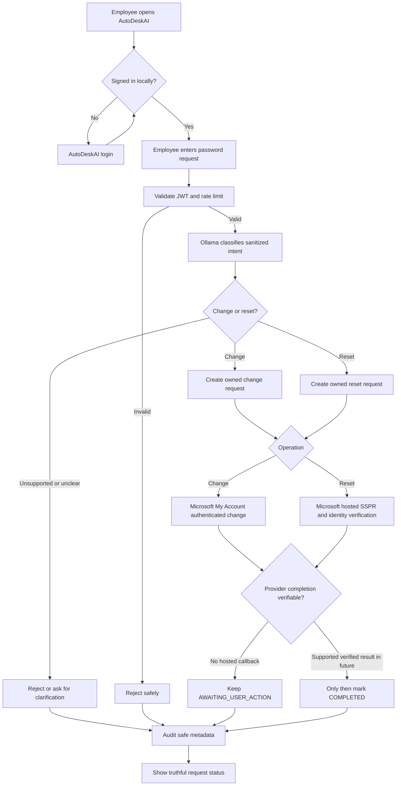

# AutoDeskAI

Authenticated IT helpdesk prototype using FastAPI, SQLAlchemy/PostgreSQL, React/Vite and Ollama. The AI classifies requests; backend policy and device ownership determine what can run. Organization password help opens Microsoft-hosted experiences and remains unverified in AutoDeskAI.

## Recent changes

This implementation preserves the existing backend foundation while completing the local helpdesk workflow, security controls, and agent/device integration. Key updates include:

- Configurable Ollama-based classification with bounded structured outputs, prompt constraints, clarification handling, and validation before actions are dispatched.
- Stronger authentication and authorization, including PBKDF2 password hashing, legacy bcrypt compatibility, expiring JWTs, server-side admin checks, and protected employee/admin APIs.
- PostgreSQL-backed request lifecycle, device ownership checks, audit history, policy enforcement, idempotent submissions, and task tracking with safe retry behavior.
- Endpoint-agent enrollment and task execution with device identity validation, local allowlist checks, simulating install results, and result idempotency protections.
- React/Vite frontend for registration, login, device enrollment, request submission, policy review, admin dashboard, and status polling.
- End-to-end demo and verification scripts for local PostgreSQL/Ollama validation without modifying production credentials.

## What works

- Employee registration, password hashing (PBKDF2-SHA256; existing bcrypt hashes supported), expiring JWTs and server-side employee/admin authorization.
- Authenticated organization password requests link to Microsoft My Account (change) or Microsoft SSPR (reset). The request stays `AWAITING_USER_ACTION` because the hosted pages do not return a verifiable result to AutoDeskAI. AutoDeskAI login passwords remain separate.
- Approved VS Code installation tasks dispatched only to the enrolled device. The endpoint agent validates its device identity and local software allowlist, simulates installation and reports a confirmed result.
- Tableau access decisions from the backend policy table. This is a **demo access decision**, not external provisioning.
- Request status/history, idempotent submissions, device heartbeat/offline checks, task timeout, audit records, and admin policy/device management.
- React login/registration, employee dashboard, helpdesk, device selection, request history, profile and admin workspace.

No Gemini dependency or API call remains. Neither model output nor API input is passed to a command runner. There is no shell execution capability in the endpoint agent.

## Prerequisites

Python 3.11+, PostgreSQL, Node.js 20.19+ or 22.12+, and Ollama with a locally installed model. Commands below run from the repository directory in PowerShell. This workspace already has its environment at `..\.venv`; for a new checkout use `.venv` instead.

## Configure and run

1. Create an environment and install dependencies:

   ```powershell
   python -m venv .venv
   .\.venv\Scripts\python.exe -m pip install -r requirements.txt
   Copy-Item .env.example .env
   ```

2. Edit the ignored `.env` privately. Set `DATABASE_URL` to a working PostgreSQL database connection. Create the empty database first using your PostgreSQL administration tool. Percent-encode special characters in connection credentials. Generate the JWT signing key directly into the file without printing it:

   ```powershell
   .\.venv\Scripts\python.exe -c "import secrets; from dotenv import set_key; set_key('.env', 'JWT_SECRET_KEY', secrets.token_urlsafe(48))"
   ```

   Keep `JWT_ALGORITHM=HS256`. Set `OLLAMA_HOST`, `OLLAMA_MODEL` (default `qwen3:8b`) and `OLLAMA_TIMEOUT` as needed. A smaller installed model can be selected without code changes. Thinking is disabled and output is bounded. Do not commit `.env`.

3. Start PostgreSQL using your local installation/service. Start Ollama if it is not already running, and install the configured model if necessary:

   ```powershell
   ollama serve
   # In another terminal, if the model is not installed:
   ollama pull qwen3:8b
   ```

4. Start the backend:

   ```powershell
   .\.venv\Scripts\python.exe check_services.py
   .\.venv\Scripts\python.exe -m uvicorn app.main:app --host 127.0.0.1 --port 8000
   ```

5. Start the frontend in a separate terminal:

   ```powershell
   cd frontend
   npm.cmd ci
   npm.cmd run dev
   ```

   Open **http://127.0.0.1:5173/**. Vite proxies `/api` to the local backend. API documentation: **http://127.0.0.1:8000/docs**. JWTs stay in browser memory; reloading signs out. The prototype binds to loopback. A production deployment needs HTTPS and a same-origin reverse proxy for `/api`.

6. Register your employee and administrator accounts through the UI. New accounts always receive the employee role. In a trusted local terminal, promote the intended administrator:

   ```powershell
   .\.venv\Scripts\python.exe -m app.manage promote-admin YOUR_ADMIN_EMAIL
   ```

   Log in to that account and open **Admin**. Enroll a device with the employee as owner. Save the one-time agent token privately in the endpoint's ignored `.env`; only its SHA-256 digest is stored by the backend. Set `SERVER_URL`, `DEVICE_ID`, `AGENT_TOKEN`, and `AGENT_SIMULATION_MODE=true`. The UI masks the token; select/copy it into the local environment file and dismiss it.

7. Start the endpoint agent from the repository directory:

   ```powershell
   .\.venv\Scripts\python.exe -m endpoint_agent.agent
   # A single heartbeat/task cycle:
   .\.venv\Scripts\python.exe -m endpoint_agent.agent --once
   ```

   Wait for its first heartbeat before submitting an installation. Admins can disable devices; disabled device tokens are rejected. Non-loopback agent connections require HTTPS. Real installation mode intentionally fails closed.

## Demonstrate the three workflows

- Sign in and submit **I forgot my password.** Use the request card to open Microsoft SSPR. The request and audit history show that a link was issued, with completion unverified.
- Select your enrolled device and submit **Install VS Code.** Leave the endpoint agent running. While a request is pending or processing, the visible UI refreshes its status every 15 seconds and shows the endpoint-confirmed simulation result.
- Submit **I need access to Tableau.** The policy table determines approval or rejection. Disable Tableau or require the admin role to demonstrate rejection.

For a repeatable live integration check, with the backend already running:

```powershell
.\.venv\Scripts\python.exe demo_e2e.py
```

This uses actual Ollama classification, PostgreSQL records and the endpoint-agent module. It creates uniquely named demo employee/admin accounts, a device and three requests. Generated credentials remain in process memory and are never printed or committed. Demo records are retained as verification history. The script checks database records, audits, Swagger, unauthenticated denial, RBAC and command rejection.

## Tests and build

```powershell
.\.venv\Scripts\python.exe -m pytest test.py -q
# Or the existing unittest entry point:
.\.venv\Scripts\python.exe -m unittest test -v
cd frontend
npm.cmd test
npm.cmd run build
```

Automated tests use an isolated in-memory SQLite database and mocked model responses; they never modify your PostgreSQL users or need a running model. The live demo separately exercises PostgreSQL and Ollama.

## Performance and reliability

- Employee requests refresh every 15 seconds while work is pending or processing; device lists refresh every 60 seconds. Mutations refresh the relevant data immediately. Admin requests refresh every 15 seconds, users/devices every 60 seconds, catalog settings every 120 seconds, and audit logs every 30 seconds while the Audit Logs page is open. Steady-state admin dashboard traffic drops from roughly 17 to 6.5 reads per minute (excluding initial loads and manual actions).
- Polling pauses in hidden tabs, coalesces refreshes, and never overlaps reads for the same job. Repeated failures back off to a maximum of two minutes. HTTP calls time out after 60 seconds, or 120 seconds for AI-assisted request creation; mutations are not automatically retried. A manual retry reuses its idempotency key only for an identical request.
- Request lists batch their related tasks. The regression test checks that a 60-request response needs at most four SQL SELECTs, including authentication and expiration checks. Startup adds missing device, task, request, and audit lookup indexes to existing tables without deleting data. Index creation can lengthen the first deployment on a large database.
- Idle expiration checks avoid empty commits, task dispatch batches policy lookups, and model classification releases the database connection while waiting. The model client reuses its HTTP connection pool. Large JSON responses use gzip compression.
- Endpoint agents poll every 10 seconds by default (`AGENT_POLL_SECONDS`, range 1–60), cache identity heartbeats for 30 seconds, and slow down during failures. Task polls still update device presence. Finalized or expired task reports no longer block new work.
- React and icon code are built as separate bundles; Vercel caches hashed assets for one year and marks API responses `no-store`. The frontend test suite covers polling, timeouts, cancellation, and swipe gestures. GitHub Actions runs the isolated backend tests, frontend tests, and production build on pushes to `main`/`backend` and on pull requests.

These changes do not eliminate hosting cold starts: a sleeping Render free service can still delay the first sign-in. Live PostgreSQL latency and end-to-end browser timing should be measured after deployment; local test timings are not production benchmarks.

## Hosted deployment (Vercel + Render + Supabase)

The frontend can be deployed from the `frontend` directory on Vercel. Set the Vercel project's root directory to `frontend`; its `vercel.json` forwards `/api` requests to the Render backend service. The rewrite currently expects the Render service URL `https://autodeskai-backend.onrender.com`, matching the service name in `render.yaml`. If Render assigns a different URL, update both rewrite destinations and redeploy Vercel.

Create a Render Blueprint from this repository and deploy the `autodeskai-backend` web service defined in `render.yaml`. Set its `DATABASE_URL` to the Supabase PostgreSQL **session pooler** connection URI in SQLAlchemy psycopg form (`postgresql+psycopg://...`) with SSL required. Keep the URI private and percent-encode special characters in its password. Render generates `JWT_SECRET_KEY` for the service.

To allow administrator self-registration, set a private `ADMIN_REGISTRATION_CODE` secret in the Render service environment. Share it only with intended administrators; the registration form requires it, and the backend rejects admin registration if it is unset or incorrect. For local development, set the same variable in the ignored `.env` file. Never commit the code to source control or expose it in frontend environment variables.

The backend's AI classification uses Ollama. The Render Blueprint uses Ollama Cloud at `https://ollama.com` with the `gemma4:31b` cloud model. Create an Ollama API key and enter it as the Render `OLLAMA_API_KEY` secret; the Ollama Python client reads this environment variable for authentication. Cloud classification sends the sanitized request representation to Ollama Cloud for processing. Keep the key out of browser code, chat, and source control. For a self-hosted Ollama server instead, set `OLLAMA_HOST`, `OLLAMA_MODEL`, and `OLLAMA_API_KEY` to values for a publicly reachable service; `localhost` on Render means the Render container itself. Do not deploy the endpoint agent unless its device can securely reach the public HTTPS backend URL; keep simulation mode enabled for the prototype.

After both services are deployed, check `https://autodeskai-backend.onrender.com/` and the Vercel site, then register a new account and submit a test request. A free Render service may sleep while idle. The frontend and backend share `/api` through the Vercel rewrite, so browser CORS configuration is not required.

## API map

| Area | Endpoints |
| --- | --- |
| Authentication | `POST /auth/register`, `POST /auth/login`, `GET /auth/me` |
| Requests | `POST /requests` (alias `POST /ai/request`), `GET /requests`, `GET /requests/{id}`, `GET /requests/{id}/history` |
| Organization password action | `POST /requests/{id}/password/action` (owned Microsoft-hosted link; no completion claim) |
| Employee devices/catalog | `GET /devices`, `GET /catalog` |
| Agent | `POST /agent/register` (admin only), `GET /agent/heartbeat`, `GET /agent/tasks`, `POST /agent/tasks/{id}/result` |
| Admin views | `GET /admin/users`, `GET /admin/requests`, `GET /admin/devices`, `GET /admin/audit` |
| Admin changes | `PUT /admin/software/{key}`, `PUT /admin/applications/{key}`, `PATCH /admin/devices/{id}` |
| Legacy user routes | `GET/POST /users`, `PUT/DELETE /users/{id}`, now admin-only; creation requires a password; deletion refuses retained history |
| Health | `GET /`, `GET /db-test` (admin only) |

Use the Swagger **Authorize** button with the access token from login. User and device tokens are distinct. Request creation requires a client-generated `idempotency_key`; reuse that key after a network failure. New intentional requests need new keys. A clarification reply supplies the previous owned request's `previous_request_id`.

HTTP errors: 400 unsupported/unsafe action; 401 invalid/expired authentication; 403 role restriction; 404 absent or inaccessible resource; 409 duplicate/state conflict; 422 malformed input; 503 AI/database unavailable. Validation errors omit submitted values to avoid echoing passwords.

## Database and execution boundaries

Startup validates the JWT configuration and adds missing tables with SQLAlchemy `create_all`. The existing `users` columns are preserved. New tables: `devices`, `helpdesk_requests`, `software_tasks`, `access_requests`, `audit_logs`, `software_policies`, `application_policies`. Existing policy settings are preserved; the demo catalog is seeded only when absent. No destructive migration runs. For future changes to existing columns, use explicit versioned migrations; `create_all` does not alter old schemas.

At startup, password requests bearing either of the two exact legacy simulation messages and status `PENDING` or `COMPLETED` are corrected to `AWAITING_USER_ACTION` with an audit entry. This preserves the record while removing an earlier false completion claim. No schema change is needed.

Request/task states include PENDING, AWAITING_USER_ACTION, PROCESSING, COMPLETED, FAILED, REJECTED and NEEDS_CLARIFICATION. Dispatch uses PostgreSQL row locks with SKIP LOCKED. Policies are rechecked before dispatch. Devices can report only their own dispatched tasks. Repeated identical result delivery is idempotent; conflicting or late results are rejected. The endpoint retries unacknowledged results during its current process lifetime. A crashed/lost task eventually fails after the configured timeout rather than silently succeeding.

Raw chat messages are not retained. Only recognized workflow tokens and canonical catalog names reach Ollama. Unknown entities are replaced with fixed unknown-target markers. This deliberately limits natural-language flexibility to reduce credential disclosure risk. The backend never displays arbitrary model prose as a success report. Audit details and endpoint result strings are backend-owned constants, not untrusted output.

## Organization password workflow



The existing local JWT identifies the AutoDeskAI user and owns the request; it does not prove that the same email belongs to a Microsoft tenant. The action endpoint accepts only the request ID, checks ownership and the operation, and returns a fixed Microsoft URL. It accepts no target account or password. It records request ID, user ID, operation, timestamp, status, and safe link-issuance detail in the existing request/audit tables. No Microsoft password, token, or secret is retained. The original request text is reduced to recognized workflow words before it is stored or sent to Ollama.

Microsoft's [My Account instructions](https://support.microsoft.com/en-us/accounts-billing/work-school/change-your-work-or-school-account-password) describe changing a known work or school password after Microsoft sign-in. Its [SSPR instructions](https://learn.microsoft.com/en-us/entra/identity/authentication/concept-sspr-deploy) describe reset and the tenant prerequisites. Enable SSPR for the pilot user or group, register enough recovery methods, assign the required license, and configure password writeback if using hybrid AD. Test with a dedicated non-admin tenant account. The app uses Microsoft's public hosted pages and needs no tenant ID, client ID, redirect URI, client secret, Graph permission, or admin consent for this link-out integration. It cannot receive a provider result or correlation ID and therefore never claims completion. The local AutoDeskAI password is unaffected.

For Vercel, deploy the frontend with the existing `/api/:path*` rewrite to Render; `/api/requests/{id}/password/action` maps to the FastAPI route without `/api`. Set backend database/JWT/Ollama variables as described above. No `VITE_` secret is needed. After deployment, register and log in as a test employee, submit each password intent, verify the owned action URL and `AWAITING_USER_ACTION` status, and complete any real password operation only within Microsoft's hosted site. Check another account receives 404 for the action and request detail. AutoDeskAI cannot confirm the result after returning from Microsoft.

## Prototype limitations

- Microsoft hosts organization password changes and resets. AutoDeskAI cannot verify completion from those hosted pages, so password requests remain AWAITING_USER_ACTION. Access provisioning and installation are explicit simulations. Only VS Code and Tableau are predefined capabilities. Adding a capability requires a code-reviewed catalog/installer change; administrators can toggle existing approvals and access roles.
- An authenticated password-reset request does not provide unauthenticated AutoDeskAI account recovery. Local signup email ownership is not verified against Entra; Microsoft independently authenticates or verifies the organization account in its hosted experience.
- Tokens expire but there is no refresh-token or immediate user-session revocation flow. Device disabling is immediate. Public registration and administrator bootstrap are intended for local development.
- Password requests are limited to five per account per hour using database history. No general production rate limiter, durable task queue, persistent endpoint result journal, distributed scheduler, or external identity/access connector is included. Task expiry is evaluated when requests/tasks/results are queried.
- Lists are bounded (200 employee requests, 500 admin records); full pagination is not implemented.
- Visual browser QA requires a connected browser. Build/HTTP verification is separate from visual verification.
