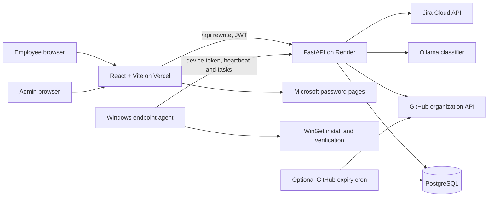
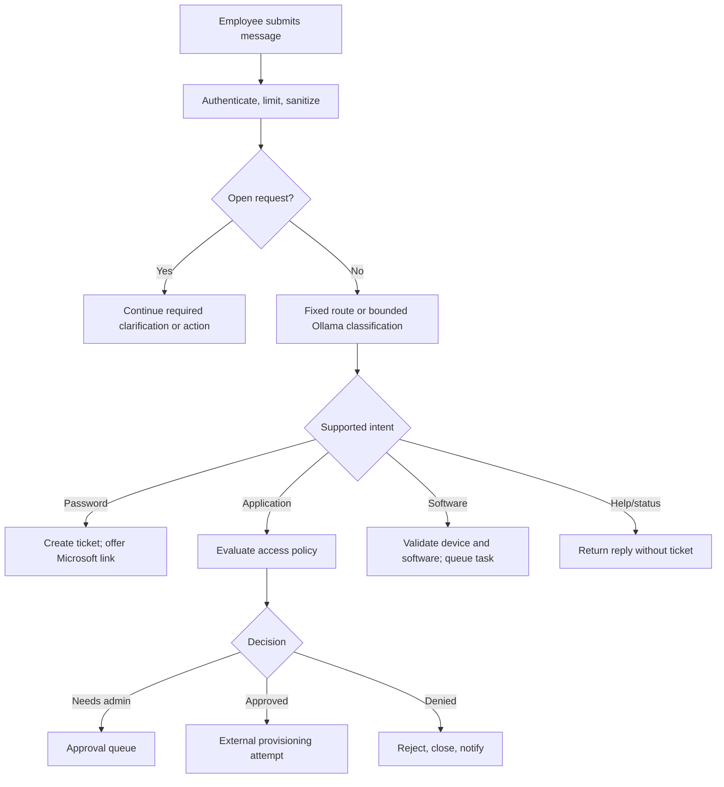

# AutoDeskAI technical documentation

**Scope:** Repository implementation as of 16 November 2026. This document describes code and declared deployment configuration. It does not claim that a particular commit is deployed or that external provider credentials have been validated in production.

## 1. System overview

AutoDeskAI is a bounded IT helpdesk prototype. A React employee portal collects requests and shows their progress. A React administrator portal manages accounts, application policies, access decisions, devices, and request history. FastAPI owns authentication, policy decisions, request state, provider calls, and auditing. PostgreSQL persists those records. Ollama classifies supported chat messages; the model cannot directly grant access or install software. A separate Windows endpoint agent receives approved software tasks and verifies installations.



| Component | Implementation | Main responsibility |
| --- | --- | --- |
| Frontend | `frontend/src`, React 19, Vite 7 | Employee/admin views, chat state, request and notification polling |
| API | `app/main.py`, FastAPI | Authenticated routes, input validation, request coordination |
| Workflow layer | `app/workflows.py`, `app/access.py` | Tickets, policy evaluation, approvals, provisioning attempts, audit |
| Classifier | `agent.py`, `prompts.py` | Sanitize and classify supported messages with bounded Ollama calls |
| Persistence | `app/models.py`, `app/database.py` | SQLAlchemy records, startup schema upgrades, sessions |
| Providers | `app/github_provider.py`, `app/jira_provider.py`, `app/provisioning.py` | External access grants and verification |
| Endpoint | `endpoint_agent`, `agent_bundle` | Token authenticated polling, fixed package installation |

## 2. Repository map

- `app/main.py` exposes HTTP routes and starts the application lifecycle.
- `app/schemas.py` contains Pydantic request/response contracts.
- `app/models.py` defines tables; `app/database.py` creates sessions and performs additive startup upgrades.
- `app/catalog.py` defines seeded software and application entries, including retired entries hidden from the catalog.
- `auth.py` handles password hashes and JWT authentication; `config.py` loads backend configuration.
- `agent.py` and `prompts.py` constrain chat classification and fallback behavior.
- `endpoint_agent/` is the Python agent source; `agent_bundle/` contains the standalone Windows installation scripts.
- `frontend/src/` contains UI components, API client, chat flow, polling logic, and JavaScript tests.
- `test.py` contains backend tests; `render.yaml` and `frontend/vercel.json` declare deployment behavior.
- `README.md` is the setup and operations guide; `PROJECT_DOCUMENTATION.md` is a general audience description.

## 3. Accounts and authorization

Employee and administrator registration collect name, birth date, username, email, and password. Employee accounts start in `PENDING`; an administrator can authorize, reject, or later deauthorize them. Pending and rejected users see their status at sign-in rather than entering the workspace. Administrator registration requires the backend-only `ADMIN_REGISTRATION_CODE`. The API rechecks approval status for authenticated requests, so a deauthorized employee cannot continue using an existing JWT.

Passwords use PBKDF2 SHA-256 for new hashes; legacy bcrypt hashes remain verifiable. JWTs are HS256 signed, include the user ID and expiration, and are sent as bearer tokens. The browser stores its JWT in tab session storage. Admin routes require an admin role; employee record routes enforce ownership. Signup currently does **not** verify email ownership, so an administrator must independently confirm identity before approving an external grant to an email account.

## 4. Request and chat processing

`POST /requests` and its `/ai/request` alias accept chat submissions. Backend checks enforce length, rate limits, ownership, idempotency, and the current open request before calling the classifier. Fixed responses handle simple help, status, and unsupported messages without a model call. The classifier returns a constrained intent; backend code decides whether to create or update a ticket. Clarification replies refer to the owned previous request. A client generated `idempotency_key` prevents duplicate tickets on uncertain retries.



Raw chat history is held in browser tab session storage and cleared on sign-out. The backend retains a sanitized ticket description and workflow/audit events, rather than a complete chat transcript. The UI polls pending requests and notifications while visible and avoids overlapping reads. A helpdesk ticket can be closed after an administrator decides an access request; the associated access record continues to track external provisioning separately.

## 5. Supported workflows

### Password help

Password reset and change tickets direct the employee to Microsoft hosted pages. The configured `MICROSOFT_SSPR_URL` supplies the recovery destination; the change flow uses Microsoft My Account. The backend records when the employee opens the action. It does not receive the organization password or independently verify completion. Where required, the employee reports the outcome; an unresolved report can trigger the supported retry or administrator escalation path.

### Software installation

The predefined software catalog currently supports Visual Studio Code (`vscode`). The employee must select an assigned, active, connected Windows device. `POST /software/requests` creates the ticket and task without an Ollama call. The endpoint agent authenticates with an enrollment token, heartbeats, claims tasks, runs WinGet for the exact allowlisted package ID `Microsoft.VisualStudioCode`, and checks WinGet's installed package list before reporting a verified result. A successful verified result ends the agent process and removes its sign-in task; the device must be started again for later work. The owner reports whether the resulting issue was resolved when the ticket calls for feedback.

Enrollment is an admin action. The API returns the agent token once and stores its digest, not the token itself. The standalone ZIP is installed on the employee's computer without Git, the repository, VS Code, or Python. The installer stores the token in that Windows user's local agent configuration. A device becomes offline after the heartbeat window. See `agent_bundle/README.md` for installation and restart instructions.

### Application access

Employees can request enabled applications with a catalog role, duration, and justification. The policy evaluator checks application availability, role, maximum duration, risk, human only roles, approval mode, and configured conditions. Unverified external facts such as HR employment, MFA, or directory membership follow the policy fallback rather than being treated as true. Policy changes increment a version and save a revision snapshot; the access request stores the version and evaluation used at submission.

Admin approval and external provisioning are separate. Rejection closes the ticket and records a reason. Approval creates `APPROVED_PROVISIONING_REQUIRED`, invokes the configured provider, and closes the helpdesk ticket without asking the employee for completion confirmation. A grant is reported as `GRANTED` only after provider verification. `MOCK` returns `SIMULATED`; no provider returns `NOT_CONFIGURED`. Failures and incomplete grants remain visible for admin retry. Employees receive stored decision notifications and see decision updates in the chat UI.

| Provider | Grant path | Verified completion | Important boundary |
| --- | --- | --- | --- |
| GitHub organization | Confirmed GitHub user ID; invite absent member | Active organization membership | Covers org member access, not team or repository roles; invitation acceptance can be pending |
| Jira Cloud | Find exact active email; invite missing user via Jira user API; add mapped group | Exact identity, group membership, and product role | Invite may need acceptance and retry; no project role or Jira expiry revocation |
| Mock / none | No external operation | Never reports a live grant | Useful for policy testing, not permission delivery |

For Jira, `USER_NOT_FOUND` on an older approved request can be retried after deploying the invitation code. An invitation can show `INVITED`; the admin retries after acceptance. A hidden or ambiguous email is `IDENTITY_MISMATCH`. The Jira user creation API needs an organization admin with Jira administration permission and may allocate a billable product seat. The current code has mocked provider tests; a real Jira invitation and group grant still needs tenant verification. Deployment must be checked separately.

An optional `app/github_expiry.py` worker revokes only eligible, provider-managed GitHub membership after expiry. `render.yaml` declares a daily cron, but declaration alone does not establish that the cron service is active or configured with database and GitHub credentials.

## 6. Data model

| Table | Key fields and purpose |
| --- | --- |
| `users` | Identity, password hash, role, and approval status |
| `github_identities` | Admin confirmed mapping from an employee to GitHub user ID/login |
| `helpdesk_requests` | Ticket intent, status, sanitized description, idempotency key, reported outcome |
| `access_requests` | Application, role, policy version, decision, approver, provider state, attempts, expiry |
| `application_policies`, `access_policy_revisions` | Current rules and historical policy snapshots |
| `devices` | Owner, device ID, token digest, heartbeat, enabled state |
| `software_tasks` | Device task, software key, claim and result state |
| `user_notifications` | Per user decision notices and read timestamps |
| `audit_logs` | Actor, action, resource, status, timestamp, bounded details |
| `chat_rate_limit_buckets` | Database backed per user request counters |
| `software_policies`, `app_settings` | Supported software toggles and operational settings |

`helpdesk_requests` is the shared ticket record. Access requests and software tasks each reference a ticket, so the ticket status and the external operation's status need not be identical. Foreign keys preserve history. Startup uses SQLAlchemy `create_all` plus additive upgrade functions; it does not wipe live data. The `_db_clear_once.py --delete` utility is destructive and is not part of normal startup.

## 7. HTTP API

FastAPI serves interactive OpenAPI documentation at `/docs`. The route summary below is intentionally grouped; the generated schema is authoritative for field types and exact response codes.

| Area | Representative endpoints | Caller |
| --- | --- | --- |
| Health | `GET /`, `GET /db-test` | Public health; admin DB test |
| Accounts | `POST /auth/register`, `POST /auth/login`, `GET /auth/me`, `PATCH /admin/users/{id}/approval` | Public registration/login; authenticated self; admin decisions |
| Helpdesk | `POST /requests`, `GET /requests`, `GET /requests/{id}`, `GET /requests/{id}/history`, resolution/retry routes | Employee for own records; admin history routes separately |
| Password | `GET /auth/password-recovery`, `POST /requests/{id}/password/action` | Public recovery configuration; authenticated owned action |
| Software | `GET /software/catalog`, `POST /software/requests`, `GET /devices` | Employee |
| Agent | `POST /agent/register`, `GET /agent/heartbeat`, `GET /agent/tasks`, `POST /agent/tasks/{id}/result` | Admin enrollment; device token thereafter |
| Access | `GET /access/applications`, `POST /access/requests`, `GET /access/requests` | Employee |
| Access administration | `/admin/access/applications`, `/admin/access/pending`, `/admin/access/requests`, decision, retry, verify routes | Admin |
| Operations | `/admin/requests`, `/admin/devices`, `/admin/audit`, `/notifications` | Admin lists; employee own notices |

Validation failures use bounded error details. Chat throttling returns HTTP 429 with `Retry-After`. The frontend API client supplies bearer tokens and does not blindly replay mutations. Each new tracked request should use a stable idempotency key when retrying an uncertain submission.

## 8. Configuration and deployment

The frontend is built with Vite and hosted on Vercel. `frontend/vercel.json` rewrites `/api` to the Render FastAPI service and disables caching on those responses. `render.yaml` defines the Python web service and optional GitHub expiry cron. The backend connects to PostgreSQL using `DATABASE_URL`; deployed agents contact the Render backend URL over HTTPS, not the Vercel frontend URL.

| Variable group | Backend settings | Purpose |
| --- | --- | --- |
| Core | `DATABASE_URL`, `JWT_SECRET_KEY`, `ADMIN_REGISTRATION_CODE` | Persistence, JWT signing, administrator registration |
| Model | `OLLAMA_HOST`, `OLLAMA_MODEL`, `OLLAMA_API_KEY`, `OLLAMA_TIMEOUT` | Bounded remote or local classification |
| Jira | `JIRA_SITE_URL`, `JIRA_ADMIN_EMAIL`, `JIRA_API_TOKEN`, `JIRA_PRODUCT_KEY`, `JIRA_ROLE_MAP` | Jira user, group, and product operations |
| GitHub | `GITHUB_ORG`, `GITHUB_TOKEN` | Organization membership and optional expiry worker |
| Chat | `CHAT_RATE_LIMIT_PER_MINUTE`, `CHAT_RATE_LIMIT_PER_HOUR`, `CHAT_OUT_OF_SCOPE_LIMIT_PER_MINUTE`, `CHAT_MAX_MESSAGE_LENGTH` | Abuse and cost controls |
| Endpoint | `TASK_TIMEOUT_SECONDS`, `DEVICE_OFFLINE_SECONDS` | Task and heartbeat windows |
| Password | `MICROSOFT_SSPR_URL` | Approved Microsoft recovery destination |

Secrets belong in Render environment settings or an ignored local `.env`, never in frontend build variables or source control. `.env.example` lists local configuration names. The endpoint has separate `SERVER_URL`, `DEVICE_ID`, `AGENT_TOKEN`, `AGENT_INSTALL_MODE`, and `AGENT_POLL_SECONDS` settings. The optional cron must receive its own `DATABASE_URL` and `GITHUB_TOKEN`.

### Local development

Use Python 3.11+, PostgreSQL, and Node.js compatible with Vite 7. Create a virtual environment, install `requirements-dev.txt`, copy `.env.example` to ignored `.env`, and configure database, JWT key, and model settings. Then start `uvicorn app.main:app` from the repository root and `npm.cmd run dev` in `frontend/`. The Vite dev server proxies `/api` to the local backend. See the exact PowerShell commands in `README.md`.

## 9. Security and operational boundaries

- Admin routes enforce role checks and employee routes enforce ownership. Device routes use a separate bearer token whose digest is stored server side.
- The model produces only a proposed intent; explicit backend validation and policy code govern all privileged actions.
- Software installation uses an allowlist, fixed WinGet package ID, argument array with `shell=False`, and installed-package verification.
- External access approval is never represented as a verified grant until provider checks succeed. Provider secrets stay on the backend.
- Audit entries cover access decisions, provisioning attempts, and request changes. Notifications are user scoped.
- Chat input is length limited and rate limited before expensive model work. The API does not retain full raw chat transcripts.
- Email ownership is not verified at signup. Jira invitation and paid seat allocation require independent identity review by the administrator.
- There is no JWT refresh flow, automatic Microsoft password outcome callback, generic software installer, Jira group expiry revocation, or general Jira project-role management.

## 10. Testing and release status

Backend tests in `test.py` use an isolated SQLite database and mocked external services. They do not prove real Jira or GitHub tenant permissions. Frontend tests use Node's test runner. The project owner previously confirmed one end-to-end Visual Studio Code installation on an enrolled Windows device; the newer agent auto-stop bundle needs a separate updated endpoint test. `demo_e2e.py --live-install` is a distinct live installation check and should run only on a designated test device and database.

```powershell
.\.venv\Scripts\python.exe -m pytest test.py -q
cd frontend
npm.cmd test
npm.cmd run build
```

For a deployment check, confirm the Git commit deployed by Render and Vercel, inspect `/docs` or the health route, and run one dedicated employee request through admin approval. Verify the resulting external membership in the provider itself and compare it with AutoDeskAI's provisioning status. A local commit, a successful frontend build, or a Render environment variable alone does not prove a live grant.

## 11. Known limits and follow-up work

The current system deliberately supports a narrow set of IT actions. Its largest identity risk is unverified signup email ownership; production use should add trusted email or enterprise identity verification before automated paid invitations. Jira invitation, group membership, and product access need a live tenant test after deployment. Jira expiry revocation is absent. GitHub expiry depends on an explicitly deployed cron. Password resolution relies on the employee's report. General RAG, voice, broader software catalogs, and automatic access for other providers are not implemented.
