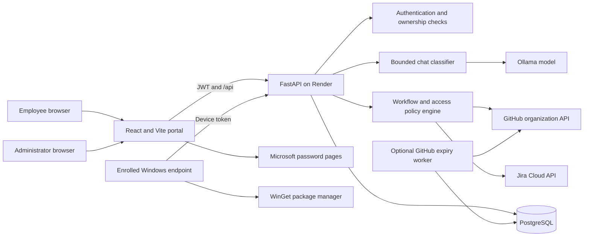
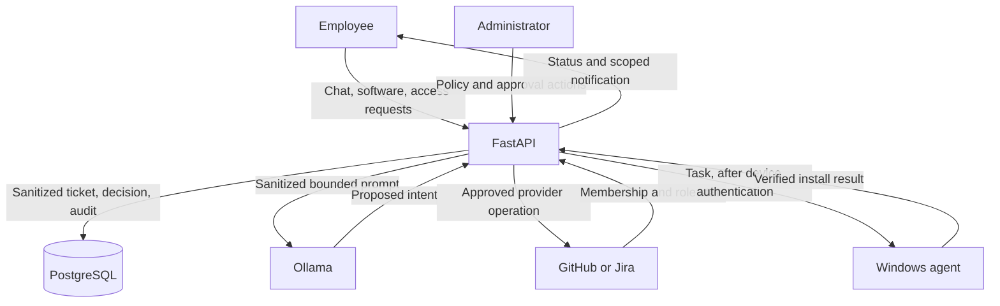
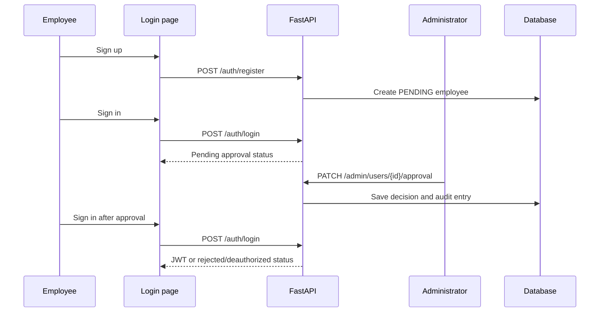
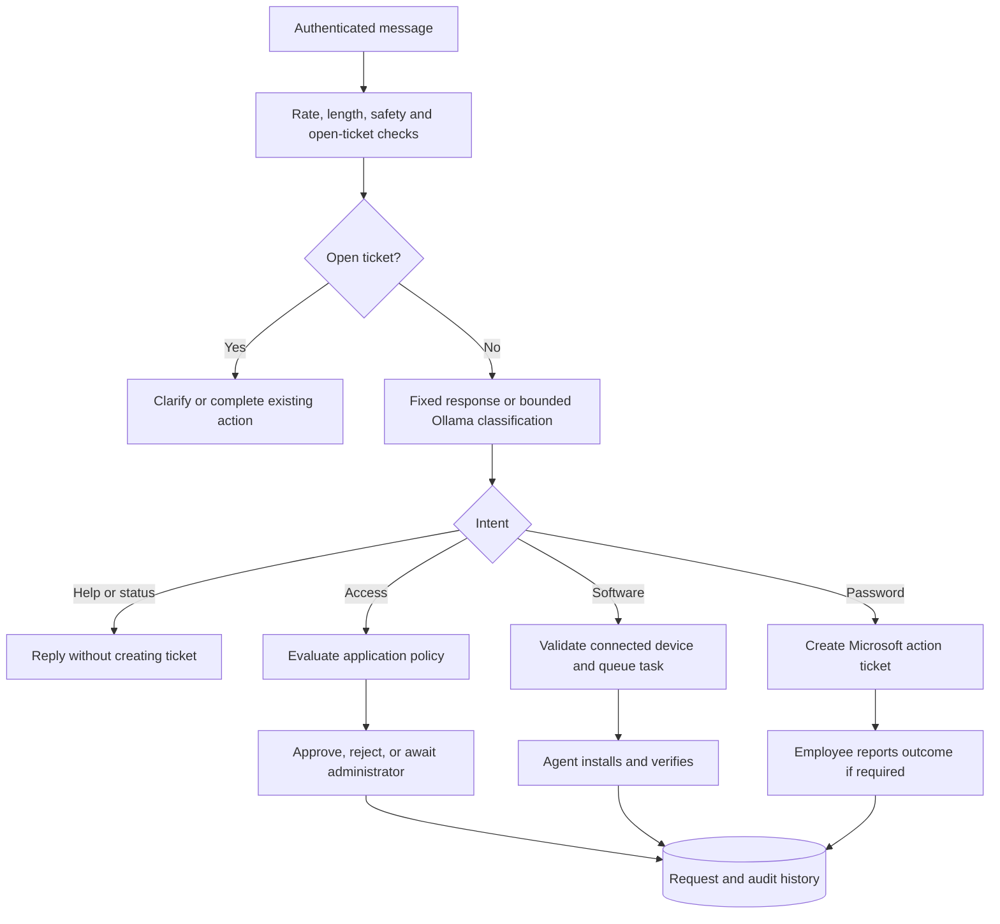
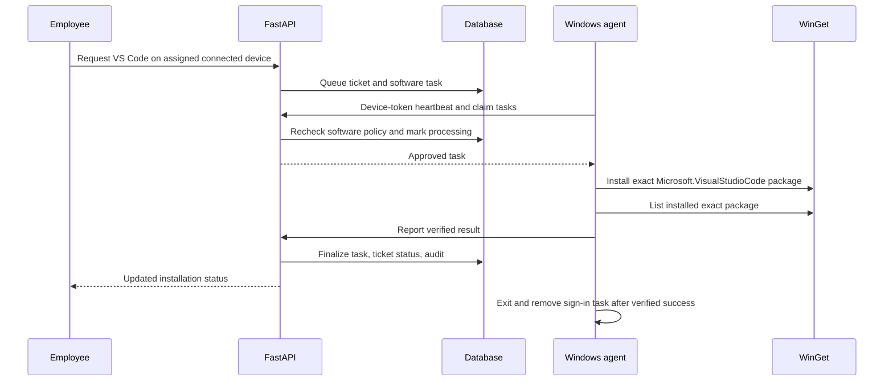

# AutoDeskAI architecture and workflow diagrams

**Basis:** Repository implementation, 16 November 2026. These diagrams explain component boundaries and state transitions. They are design/implementation diagrams, not screenshots of a running deployment.

## 1. Runtime architecture



The browser owns display state and tab-local chat history. FastAPI owns authorization, request and policy state, audit, and provider calls. The classifier supplies an intent to backend code; it has no direct authority over providers or endpoints. The Windows agent authenticates separately from user JWTs. Vercel rewrites `/api` to Render; the agent uses the Render URL directly.

**Implementation references:** [`frontend/vercel.json`](../frontend/vercel.json), [`app/main.py`](../app/main.py), [`app/access.py`](../app/access.py), [`endpoint_agent/agent.py`](../endpoint_agent/agent.py), [`render.yaml`](../render.yaml).

## 2. Data ownership and flow



The database stores users, tickets, access requests, policy revisions, audit entries, notifications, devices, and tasks. Employees read only their own records. Raw chat transcripts remain in the browser tab session; tracked tickets store bounded sanitized descriptions. Provider credentials stay on the backend. See [`app/models.py`](../app/models.py) for the table definitions.

## 3. Account authorization workflow



Employee approval is separate from a Jira or GitHub application grant. AutoDeskAI signup does not verify email ownership, so the administrator must verify the intended person's external identity before approving paid or privileged access.

## 4. Chat and ticket workflow



Client-generated idempotency keys prevent duplicate tracked requests on retry. A pending clarification continues the same owned request. One open tracked request blocks an unrelated new one. Helpdesk closure and external provisioning status are separate records.

## 5. Application access workflow

```mermaid
sequenceDiagram
    participant E as Employee
    participant API as Backend policy engine
    participant A as Administrator
    participant P as External provider
    E->>API: Submit application, role, duration, justification
    API->>API: Validate catalog and evaluate versioned policy
    alt Requires human approval
        API-->>A: Pending request
        A->>API: Approve or reject
    else Eligible automatic decision
        API->>API: Record policy decision
    end
    alt Rejected
        API-->>E: Decision notification; ticket closed
    else Approved
        API->>P: Attempt configured grant
        P-->>API: Invitation or membership state
        API->>P: Verify identity, group and product/membership
        alt Verified
            API-->>E: GRANTED notification
        else Not yet verified
            API-->>A: Provisioning status and retry action
        end
    end
```

For GitHub, an absent confirmed account is invited and remains `PENDING_ACCEPTANCE` until active membership is verified. For Jira, an absent exact email can be invited using the Jira user API. `INVITED` is not a grant; after acceptance the administrator retries verification. Jira requires an exact visible email, mapped group, and configured product role. `MOCK` and `NONE` providers never represent a live grant.

## 6. Software installation workflow



The endpoint must be assigned to the requester, active, Windows, and within the heartbeat window. The agent only accepts the predefined software key and reports success after installed-package verification. For a later task, start the installed agent again and wait for Connected. See [`endpoint_agent/installer.py`](../endpoint_agent/installer.py) and [`agent_bundle/README.md`](../agent_bundle/README.md).

## 7. Ticket and provisioning states

| Record | Representative states | Meaning |
| --- | --- | --- |
| Helpdesk ticket | `NEEDS_CLARIFICATION`, `AWAITING_USER_ACTION`, `AWAITING_ADMIN`, `PROCESSING`, `COMPLETED`, `CLOSED` | Conversation and support process |
| Access request | `AWAITING_ADMIN`, `APPROVED_PROVISIONING_REQUIRED`, `COMPLETED`, `REJECTED` | Decision and external access process |
| Provider result | `NOT_STARTED`, `NOT_CONFIGURED`, `SIMULATED`, `PENDING_ACCEPTANCE`, `INVITED`, `GRANTED`, `FAILED`, `USER_NOT_FOUND`, `IDENTITY_MISMATCH`, `PRODUCT_ACCESS_REQUIRED` | Grant verification or reason for follow-up |
| Software task | `PENDING`, `PROCESSING`, `COMPLETED`, `FAILED`, `REJECTED` | Endpoint execution |

An admin decision closes the helpdesk ticket without employee confirmation. A provider can still be pending. A software task's verified result and the employee's reported resolution are separate facts.

## 8. Report-ready figure set

The existing [11 SVG report figures](../report/figures/README.md) include the system architecture (5.1), data flow (5.2), request lifecycle (5.3), functional workflow (3.1), testing workflow (7.1), and secure processing workflow (8.1). They are illustrative diagrams. Figure 6.1 and 6.2 are redraws rather than captured UI/API screenshots. For implementation evidence, use the code paths and test records in [Testing and Implementation Evidence](TESTING_AND_EVIDENCE.md).
